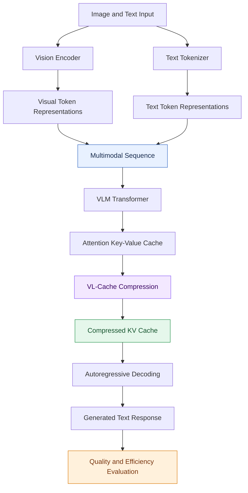
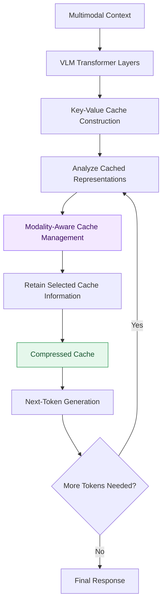
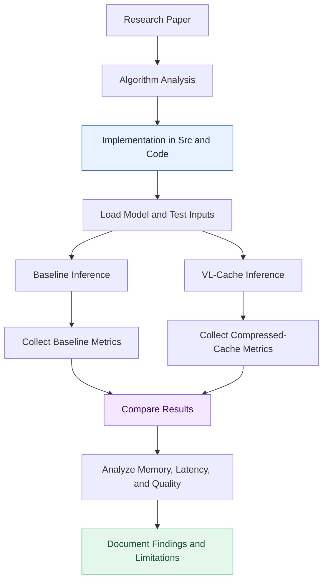

# Efficient VLM Inference
### Implementation and Evaluation of VL-Cache: Modality-Aware KV-Cache Compression for Vision-Language Models

<p align="center">
  
  
  
  
  
  
</p>

---

## Abstract

Vision-Language Models (VLMs) combine visual representations with language-model reasoning to support tasks such as image understanding, visual question answering, and multimodal instruction following. However, processing high-resolution images and multiple images can introduce large numbers of visual tokens, increasing inference-time memory consumption and computational overhead.

A significant source of memory consumption during autoregressive generation is the **Key-Value (KV) cache**, which stores attention keys and values from previously processed tokens. In multimodal models, the cache can contain both visual and textual representations, making its management particularly important for long-context and image-intensive workloads.

This repository focuses on the implementation and evaluation of **VL-Cache**, a modality-aware KV-cache compression method designed to improve Vision-Language Model inference efficiency.

The project investigates how modality-aware cache management can reduce memory requirements while preserving the information needed for downstream generation. It provides an experimental foundation for studying KV-cache compression, inference optimization, and the deployment of VLMs in resource-constrained environments.

---

## Table of Contents

1. [Overview](#-overview)
2. [Research Objectives](#-research-objectives)
3. [System Architecture](#️-system-architecture)
4. [Background: KV Cache in VLMs](#-background-kv-cache-in-vlms)
5. [VL-Cache Methodology](#-vl-cache-methodology)
6. [Experimental Workflow](#-experimental-workflow)
7. [Evaluation Methodology](#-evaluation-methodology)
8. [Installation and Setup](#-installation-and-setup)
9. [Running Experiments](#-running-experiments)
10. [Project Structure](#-project-structure)
11. [Limitations and Future Work](#-limitations-and-future-work)
12. [Technologies](#️-technologies)
13. [References](#-references)
14. [Authors](#-authors)
15. [License](#-license)
16. [Support](#-support)

---

## 📌 Overview

Efficient inference is an important challenge for modern VLMs. When an image is converted into visual tokens, these representations are processed alongside the language-model context. During autoregressive generation, attention keys and values are stored in a KV cache to avoid recomputing representations for previously processed tokens.

As the context grows, the cache can become a substantial memory bottleneck.

This project investigates VL-Cache, which addresses this problem through **modality-aware KV-cache compression**. Instead of treating every cached representation identically, the method considers the differences between visual and textual information when allocating cache capacity.

### Key Research Areas

- **KV-cache compression:** Reduce the memory required to retain attention keys and values.
- **Modality awareness:** Account for the different roles of visual and textual tokens.
- **Inference optimization:** Investigate the relationship between cache size, latency, and generation quality.
- **Resource efficiency:** Explore more practical VLM inference under limited GPU memory.
- **Experimental reproducibility:** Organize implementation and evaluation into a structured research workflow.

### Motivation

The memory requirements of a VLM can increase significantly when processing high-resolution images, multiple images, or long conversations.

For example, if each image contributes \(N\) visual tokens, processing \(M\) images can introduce approximately \(M \times N\) visual tokens before accounting for other tokens and model-specific processing.

The resulting KV-cache footprint depends on the architecture, number of layers, number of attention heads, cache precision, and sequence length.

Reducing this footprint can make longer contexts and more image-intensive workloads more practical.

---

## 🎯 Research Objectives

The primary objectives of this project are:

1. **Implement VL-Cache:** Reproduce the core cache-compression method described in the original research paper.
2. **Reduce inference memory:** Investigate the impact of cache compression on KV-cache memory consumption.
3. **Preserve generation quality:** Examine the trade-off between cache reduction and downstream VLM performance.
4. **Measure inference efficiency:** Evaluate runtime behavior, memory usage, and generation latency.
5. **Study multimodal workloads:** Investigate the challenges introduced by visual tokens and their interaction with textual context.
6. **Establish a foundation for further research:** Identify opportunities for improved cache compression and deployment on resource-constrained devices.

---

## 🏗️ System Architecture

The system consists of a pretrained Vision-Language Model, a multimodal input pipeline, a KV-cache management mechanism, and an autoregressive generation stage.

### Overall System Model



*Figure 1. Conceptual architecture of modality-aware KV-cache compression in VLM inference. The exact insertion point and cache-selection operations depend on the model architecture and VL-Cache implementation.*

### System Components

| Component | Description |
|---|---|
| Multimodal input | Image(s) and accompanying text or instructions. |
| Vision encoder | Converts images into visual representations. |
| Text tokenizer | Converts textual input into token representations. |
| VLM Transformer | Processes multimodal context using attention layers. |
| KV cache | Stores previously computed attention keys and values. |
| VL-Cache | Applies modality-aware cache-compression operations. |
| Autoregressive decoder | Generates subsequent output tokens using the retained context. |
| Evaluation pipeline | Measures memory consumption, inference latency, and output quality. |

---

## 🧠 Background: KV Cache in VLMs

### What Is a KV Cache?

Transformer attention uses queries, keys, and values. During autoregressive generation, the keys and values from previously processed tokens can be retained and reused instead of recomputed at every decoding step.

For a transformer layer, the attention operation can be represented as:

\[
\operatorname{Attention}(Q,K,V)
=
\operatorname{softmax}
\left(
\frac{QK^\top}{\sqrt{d_k}}
\right)V
\]

Here, \(Q\), \(K\), and \(V\) represent queries, keys, and values, respectively, while \(d_k\) is the key dimension.

The KV cache stores the relevant \(K\) and \(V\) tensors for subsequent generation steps.

### Why Is the KV Cache Expensive?

The cache grows with the number of cached tokens, transformer layers, attention heads, and the dimensions and precision of the stored tensors.

A simplified estimate for a conventional decoder cache is:

\[
M_{\mathrm{KV}}
\approx
2 L B T H_{\mathrm{KV}} d_h b
\]

where:

- \(L\): number of transformer layers.
- \(B\): batch size.
- \(T\): number of cached tokens.
- \(H_{\mathrm{KV}}\): number of key-value heads.
- \(d_h\): dimension per key-value head.
- \(b\): bytes per stored element.
- The factor \(2\) accounts for keys and values.

This estimate excludes additional overhead and assumes a conventional cache layout. Actual memory consumption depends on the architecture and implementation.

### Why Does Modality Matter?

Visual and textual tokens play different roles in multimodal reasoning. Images can contribute many visual tokens, and some workloads contain multiple images or high-resolution image representations.

A cache-compression strategy that considers modality can allocate its cache budget differently from a strategy that treats every token identically.

The challenge is to reduce redundant or less important cached information without removing context that is necessary for correct generation.

---

## ⚙️ VL-Cache Methodology

VL-Cache focuses on **modality-aware KV-cache compression** for Vision-Language Model inference.

At a high level, the method manages cached attention representations to reduce their memory footprint while attempting to retain useful multimodal context.

### Conceptual Workflow



*Figure 2. High-level illustration of a cache-compression loop. It is a conceptual summary, not a replacement for the algorithm, cache-selection equations, or implementation details in the original paper.*

### Main Design Considerations

**1. Cache memory reduction**

The method aims to reduce the number of cached elements or the storage required for retained key-value tensors.

**2. Modality-aware treatment**

Visual and textual context can contribute differently to the model's prediction process. Cache management must account for these differences.

**3. Generation quality**

Removing cache information may affect attention patterns and generated responses. Quality should therefore be measured at multiple compression settings.

**4. Runtime overhead**

Compression itself introduces computation. A useful optimization should be evaluated for end-to-end latency rather than cache size alone.

**5. Model compatibility**

The implementation must account for differences in cache layouts, attention implementations, and multimodal architectures.

For exact algorithmic details, including cache-selection criteria and compression parameters, consult the original VL-Cache paper and the implementation in this repository.

---

## 🔄 Experimental Workflow

The research workflow can be divided into implementation, baseline evaluation, compressed-cache evaluation, and result analysis.



### Baseline and Compressed Inference

A fair experiment should compare the unmodified inference pipeline against the VL-Cache implementation under equivalent conditions.

Where possible, hold the following constant:

- Model checkpoint and model configuration.
- Input images and text prompts.
- Image resolution and preprocessing.
- Generation parameters and output length.
- Hardware and software environment.
- Batch size and measurement methodology.

Record the cache budget or compression setting for each experiment.

---

## 📊 Evaluation Methodology

The goal of evaluation is to determine whether VL-Cache reduces resource requirements without unacceptable degradation in output quality.

### Recommended Metrics

| Metric | Purpose |
|---|---|
| KV-cache memory | Measures memory allocated to cached keys and values. |
| Peak GPU memory | Measures the maximum GPU memory used during inference. |
| Time to first token | Measures the delay before generation begins. |
| Inter-token latency | Measures the time between generated tokens. |
| End-to-end latency | Measures the total inference duration. |
| Throughput | Measures the number of generated tokens per unit of time. |
| Task performance | Measures output quality on a suitable VLM benchmark. |
| Compression ratio | Measures the reduction in cache size relative to the baseline. |

A useful definition of cache memory reduction is:

\[
R_{\mathrm{memory}}
=
\frac{M_{\mathrm{baseline}}-M_{\mathrm{compressed}}}
{M_{\mathrm{baseline}}}
\times 100\%
\]

where \(M_{\mathrm{baseline}}\) and \(M_{\mathrm{compressed}}\) are the measured KV-cache memory footprints before and after compression.

### Results Table Template

Populate the following table with measurements obtained from your experiments.

| Configuration | KV-Cache Memory | Peak GPU Memory | Latency | Task Score |
|---|---:|---:|---:|---:|
| Baseline | To measure | To measure | To measure | To measure |
| VL-Cache | To measure | To measure | To measure | To measure |

Use the same test inputs and measurement procedures for both configurations. Clearly identify the benchmark, model, hardware, and compression setting when reporting final results.

**Important:** Reduced KV-cache size does not automatically imply lower peak GPU memory or faster end-to-end inference. These are separate metrics and should be measured independently.

---

## 🚀 Installation and Setup

### Prerequisites

The exact dependencies depend on the model, framework, and implementation used in the repository.

Typical requirements for a PyTorch-based VLM inference experiment include:

- Python.
- PyTorch.
- Hugging Face Transformers or the framework used by the implementation.
- The model's required vision and text-processing dependencies.
- A compatible GPU environment if the selected model requires GPU acceleration.

### Clone the Repository

```bash
git clone https://github.com/bhzadjnty7/Efficient-VLM-Inference.git

cd Efficient-VLM-Inference
```

### Inspect the Project Files

The repository contains two primary directories:

- `Code/` — experiment and implementation-related files.
- `Src/` — source-code files.

Inspect these directories to identify the relevant entry points, configuration files, and dependency requirements before running the experiments.

### Install Dependencies

If the repository includes a dependency file, install the listed packages using that file. Otherwise, use the package requirements documented in the implementation or notebook.

```bash
pip install torch transformers
```

This command installs common baseline libraries only; it is not a complete dependency specification for every VLM or VL-Cache configuration.

**Environment note:** Match PyTorch, CUDA, Transformers, and model-specific dependencies to the versions required by your implementation. A successful installation of the base libraries does not guarantee that all experiments will run without additional setup.

---

## ▶️ Running Experiments

The exact execution command depends on the entry point and configuration supplied in `Code/` and `Src/`.

A typical experimental sequence is:

1. Inspect the implementation and identify its model-loading configuration.
2. Prepare the model checkpoint and required test inputs.
3. Run baseline inference with cache compression disabled.
4. Run inference using the VL-Cache implementation.
5. Record memory, latency, and output-quality metrics.
6. Compare the results under equivalent experimental conditions.

For reproducibility, record the model identifier, hardware, software versions, input configuration, generation settings, and cache-compression parameters for each run.

---

## 📁 Project Structure

```text
Efficient-VLM-Inference/
│
├── Code/
│   └── Experiment and implementation-related files
│
├── Src/
│   └── Source-code files
│
├── LICENSE
│   └── MIT License
│
└── README.md
    └── Project documentation
```

This is a high-level representation of the repository's observed top-level structure. The specific files and responsibilities within `Code/` and `Src/` should be documented as their contents are inspected.

---

## 🔬 Limitations and Future Work

### Current Research Challenges

**Model generalization**

A compression method should be evaluated across compatible VLM architectures to understand whether its benefits generalize beyond a single model configuration.

**Quality versus compression**

Aggressive compression may reduce memory consumption but remove information required for complex reasoning or detailed visual understanding.

**High-resolution and multi-image workloads**

Long visual contexts increase cache requirements and provide important test cases for measuring scalability.

**End-to-end latency**

The overhead of cache management can offset some of the benefits of reduced cache size. End-to-end measurements are therefore essential.

**Reproducibility**

Differences in cache implementations, GPU environments, model versions, and input processing can affect reported performance.

### Future Directions

- **Broader model evaluation:** Compare compatible VLM architectures under the same workload.
- **Adaptive cache budgets:** Investigate whether cache capacity can be adjusted according to input complexity and modality.
- **Token-pruning integration:** Explore complementary approaches that reduce the number of visual tokens entering the language model.
- **Cache quantization:** Study whether lower-precision cache storage can complement cache selection.
- **Long-context experiments:** Evaluate workloads containing multiple images or extended multimodal conversations.
- **Edge deployment:** Measure the feasibility of running compressed VLM inference under limited memory and power budgets.
- **Automated benchmarking:** Build a repeatable evaluation suite for memory, latency, throughput, and task quality.

These are potential research directions rather than claims that the corresponding features are already implemented.

---

## 🧰 Technologies

| Technology or Concept | Role |
|---|---|
| Vision-Language Models | Multimodal understanding and generation |
| KV cache | Reuse of attention keys and values during autoregressive decoding |
| VL-Cache | Modality-aware KV-cache compression |
| PyTorch | Model computation and inference |
| Python | Implementation and experimentation |
| Hugging Face ecosystem | Model loading and multimodal inference, where applicable |
| Google Colab | Potential GPU-based experimentation environment |
| Mermaid | Architecture and workflow diagrams |

The exact dependencies and runtime environment should be confirmed against the repository's implementation.

---

## 📚 References

1. **VL-Cache: Sparsity and Modality-Aware KV Cache Compression for Vision-Language Model Inference Acceleration.** Refer to the original publication for the precise algorithm, equations, and experimental methodology.
2. [Efficient-VLM-Inference — Project Repository](https://github.com/bhzadjnty7/Efficient-VLM-Inference)
3. [Hugging Face Transformers Documentation](https://huggingface.co/docs/transformers/index)
4. [PyTorch Documentation](https://pytorch.org/docs/stable/index.html)

For academic use, add the original paper's author list, publication venue, year, DOI, or arXiv identifier once verified.

---

## 👨‍💻 Authors

**Behzad Jannati**  
M.Sc. Student — Computer Engineering, Computer Architecture  
University of Tehran

- GitHub: [bhzadjnty7](https://github.com/bhzadjnty7)
- LinkedIn: [behzadjannati](https://www.linkedin.com/in/behzadjannati)

**Farzad Jannati**

- GitHub: [farzadjannati](https://github.com/farzadjannati)

**Institution:** University of Tehran (ECE)

---

## 📄 License

This project is distributed under the [MIT License](LICENSE).

---

## 🤝 Contributing

Contributions, bug reports, and suggestions for improving the implementation or evaluation methodology are welcome.

You can contribute by:

- Reporting implementation issues.
- Suggesting additional benchmark workloads.
- Improving experiment reproducibility.
- Adding compatible model configurations.
- Contributing evaluation scripts and documentation.

Please ensure that experimental claims are supported by reproducible measurements.

---

## ⭐ Support

If you find this project useful for your research or development, consider giving the repository a star.

<p align="center">
  <sub>Built with ❤️ for efficient Vision-Language Model inference and multimodal systems research.</sub>
</p>
